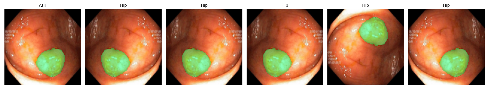
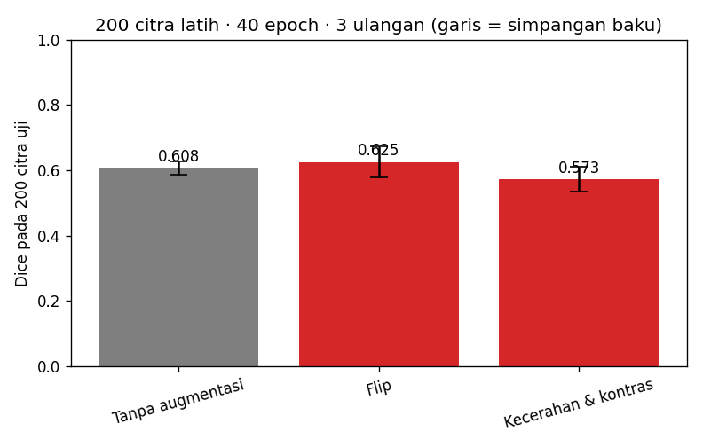
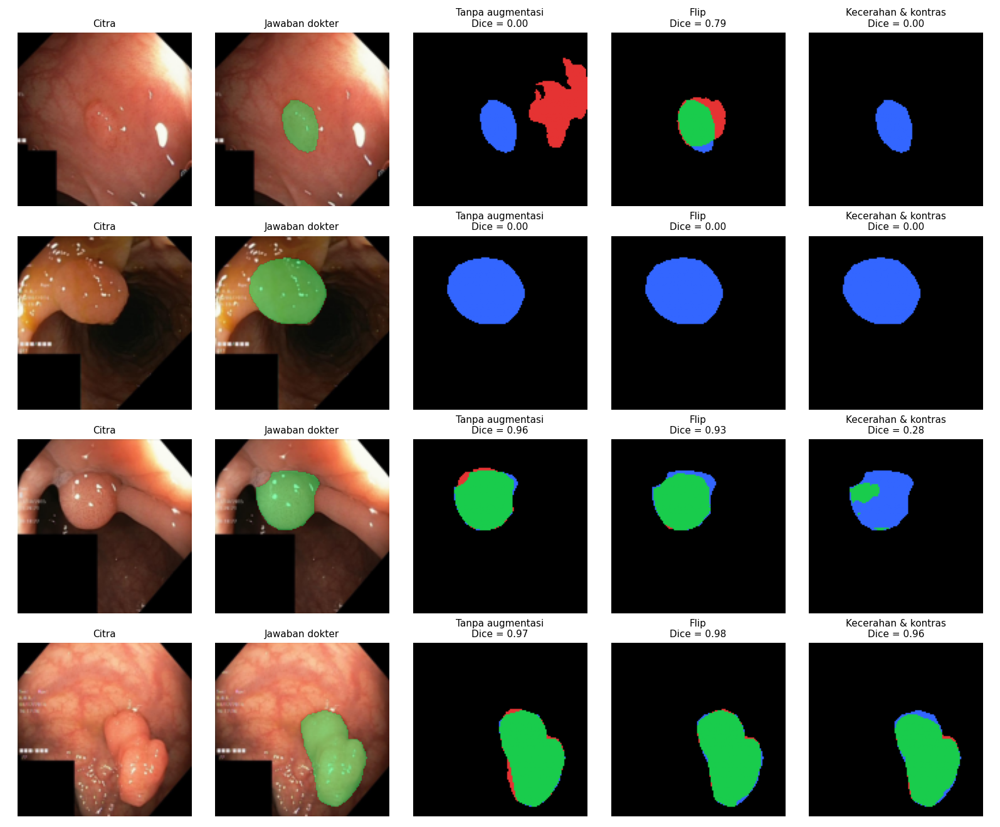

# Segmentasi Polip pada Citra Kolonoskopi dengan U-Net

<!--
  TEMPLATE LAPORAN — Tugas P10 Kecerdasan Buatan (BM25-41204), Teknik Biomedis ITERA.
  Petunjuk lengkap: https://mctm.web.id/ai-bm/tugas

  Cara memakai:
  - Ganti semua teks yang diawali "✍️" dengan tulisan kelompokmu, lalu hapus tanda ✍️-nya.
  - Blok komentar seperti ini adalah petunjuk; tidak tampil di GitHub. Boleh dihapus.
  - Gambar diambil dari folder hasil/ yang dibuat otomatis oleh notebook.
  - Jangan hapus judul-judul bagian (##).
-->

**Tugas P10 — Kecerdasan Buatan (BM25-41204), Teknik Biomedis ITERA**

## Anggota kelompok

| Nama | NIM | Username GitHub | Kontribusi utama |
|---|---|---|---|
| Azaria Fadilah | 123430065 | Azafadilah | Menyiapkan lingkungan eksperimen, menjalankan model U-Net, serta melakukan pengujian dan pengumpulan hasil eksperimen. |
| Jihan Nailah Efrani | 123430005 | jihannaila03-png | Merancang skenario augmentasi citra, menentukan hipotesis, serta menganalisis pengaruh augmentasi dan mengerjakan README. |
| Nur Fathiah Hutriani| 123430021 | fathiahutriani-spec | Melakukan analisis hasil segmentasi, mengevaluasi peta kesalahan (false positive dan false negative), serta menyusun README. |

## 1. Pertanyaan

Augmentasi apa yang membantu U-Net menemukan polip pada citra kolonoskopi, dan augmentasi apa yang tidak? Kenapa?

## 2. Data & pengaturan

<!-- Isi dari Bagian 2 notebook. Pastikan CEPAT = False untuk hasil akhir. -->

- Dataset: Kvasir-SEG (1000 citra kolonoskopi + mask polip), diperkecil ke 128 × 128 piksel.
- Data uji: 200 citra (tetap). Data latih: 200 citra per ulangan.
- Model: U-Net mini (±0,5 juta parameter), 40 epoch, 3 ulangan per skenario.
- Dijalankan di: Google Colab T4.


## 3. Skenario augmentasi & hipotesis

<!-- Tulis bagian ini SEBELUM menjalankan eksperimen. Commit dulu, baru jalankan.
     Alasan klinis = kenapa variasi ini mungkin (atau tidak mungkin) terjadi pada kolonoskopi sungguhan. -->

| Skenario | Augmentasi (kode) | Alasan klinis | Hipotesis: Dice naik/turun/sama? |
|---|---|---|---|
| Tanpa augmentasi | — | Pembanding | — |
| Flip | `v2.Compose([v2.RandomHorizontalFlip(), v2.RandomVerticalFlip()])` | Orientasi kamera kolonoskopi dapat berubah. Flip digunakan untuk melatih model mengenali polip pada orientasi berbeda. | Naik, dibandingkan tanpa augmentasi, karena model diharapkan tidak bergantung pada orientasi polip. |
| Kecerahan & kontras |  `v2.ColorJitter(brightness=0.3, contrast=0.3)` | Tampilan pencahayaan citra dapat bervariasi. Augmentasi ini meniru variasi terang dan kontras. | Naik dibandingkan tanpa augmentasi, karena model diharapkan lebih tahan terhadap variasi pencahayaan. |

Contoh augmentasi yang dicoba:


<!-- Ganti nama file sesuai skenario kalian (lihat isi folder hasil/). -->

## 4. Hasil

<!-- Tempel isi hasil/ringkasan.md di sini. -->

| Skenario | Dice Ulangan 1 | Dice Ulangan 2 | Dice Ulangan 3 | IoU Ulangan 1 | IoU Ulangan 2 | IoU Ulangan 3 |
|---|---|---|---|---|---|---|
| Tanpa augmentasi | 0.591 | 0.637 | 0.596 | 0.471 | 0.525 | 0.470 |
| Flip | 0.609 | 0.689 | 0.578 | 0.506 | 0.578 | 0.451 |
| Kecerahan & kontras | 0.521 | 0.607 | 0.591 | 0.417 | 0.495 | 0.481 |

| Skenario | Dice (rata-rata ± sb) | IoU (rata-rata ± sb) | Dice tiap ulangan |
|---|---|---|---|
| Tanpa augmentasi | 0.608 ± 0.021 | 0.489 ± 0.026 | 0.591, 0.637, 0.596 |
| Flip | 0.625 ± 0.047 | 0.512 ± 0.052 | 0.609, 0.689, 0.578 |
| Kecerahan & kontras | 0.573 ± 0.038 | 0.464 ± 0.034 | 0.521, 0.607, 0.591 |


https://colab.research.google.com/drive/1w1V2An1FVl76gLMSBKYOQXX3Zs7agU-a#scrollTo=14dd4f45&fullscreenOutput=true

## 5. Analisis peta kesalahan
Berdasarkan visualisasi peta kesalahan segmentasi, terlihat bahwa performa model U-Net berbeda pada setiap skenario augmentasi. Pada skenario tanpa augmentasi, terdapat citra dengan nilai Dice 0,00 karena hasil prediksi belum mampu mendeteksi area polip yang sesuai dengan anotasi dokter. Namun, pada citra lainnya model mampu menghasilkan segmentasi yang cukup baik dengan nilai Dice 0,96 dan 0,97. Pada skenario Flip, hasil segmentasi terlihat lebih mendekati anotasi dokter, seperti pada citra pertama dengan Dice 0,79 dan citra keempat dengan Dice 0,98. Hal ini menunjukkan bahwa augmentasi Flip membantu model mengenali polip pada variasi orientasi citra.

Sementara itu, skenario kecerahan dan kontras menunjukkan hasil yang bervariasi. Beberapa citra memiliki nilai Dice 0,00 dan 0,28, yang menunjukkan bahwa model belum mampu melakukan segmentasi secara optimal. Namun, pada citra keempat diperoleh Dice 0,96 dengan hasil segmentasi yang cukup mendekati anotasi dokter. Secara keseluruhan, peta kesalahan menunjukkan bahwa augmentasi Flip memberikan hasil segmentasi yang relatif lebih baik pada beberapa citra. Kesalahan segmentasi masih ditemukan berupa ketidaksesuaian batas polip dan kegagalan mendeteksi area polip secara keseluruhan. Hal ini menunjukkan bahwa kemampuan model U-Net masih dipengaruhi oleh bentuk, ukuran, dan karakteristik visual polip pada citra kolonoskopi.


<!-- Hijau = benar, merah = false positive, biru = false negative.
     Pertanyaan pemandu: Polip seperti apa yang sering terlewat (kecil? datar? warna mirip dinding usus?)
     Apa yang sering dikira polip padahal bukan? Apakah augmentasi memperbaiki kasus sulit? -->
https://colab.research.google.com/drive/1w1V2An1FVl76gLMSBKYOQXX3Zs7agU-a#scrollTo=0b460587&fullscreenOutput=true

## 6. Pembahasan & kesimpulan

<!-- Bandingkan hasil dengan hipotesis di Bagian 3. Hipotesis yang ternyata salah tetap bernilai,
     asalkan dijelaskan kenapa. Perbedaan kecil (lebih kecil dari simpangan baku) belum tentu berarti. -->

Berdasarkan hasil pengujian, augmentasi Flip menghasilkan nilai Dice tertinggi sebesar 0,625 ± 0,047 dan IoU sebesar 0,512 ± 0,052 dibandingkan tanpa augmentasi maupun augmentasi kecerahan dan kontras. Hal ini menunjukkan bahwa augmentasi Flip membantu model U-Net mengenali polip dengan variasi orientasi citra kolonoskopi.

Sementara itu, augmentasi kecerahan dan kontras menghasilkan nilai Dice sebesar 0,573 ± 0,038 dan IoU sebesar 0,464 ± 0,034. Hasil tersebut lebih rendah dibandingkan tanpa augmentasi yang memperoleh Dice 0,608 ± 0,021 dan IoU 0,489 ± 0,026. Hal ini menunjukkan bahwa perubahan intensitas pencahayaan dan kontras pada pengaturan yang digunakan belum tentu meningkatkan kemampuan segmentasi model.

Dengan demikian, hipotesis bahwa augmentasi Flip dapat meningkatkan performa segmentasi didukung oleh hasil pengujian, sedangkan augmentasi kecerahan dan kontras belum menunjukkan peningkatan. Namun, karena perbedaan nilai Dice Flip dan tanpa augmentasi (0,017) lebih kecil daripada simpangan baku masing-masing, peningkatan tersebut belum dapat dinyatakan signifikan secara statistik.

## 7. Pembagian kerja

<!-- Siapa mengerjakan apa. Penilaian proses kerja dilihat dari riwayat commit tiap anggota. -->

| Nama | NIM | Username GitHub | Kontribusi utama |
|---|---|---|---|
| Azaria Fadilah | 123430065 | Azafadilah | Menyiapkan lingkungan eksperimen, menjalankan model U-Net, melakukan pengujian, dan mengumpulkan hasil eksperimen. |
| Jihan Nailah Efrani | 123430005 | jihannaila03-png | Merancang skenario augmentasi citra, menentukan hipotesis, menganalisis pengaruh augmentasi, dan mengerjakan README. |
| Nur Fathiah Hutriani | 123430021 | fathiahutriani-spec | Menganalisis hasil segmentasi, mengevaluasi peta kesalahan (false positive dan false negative), serta menyusun README. |

## 8. Penggunaan AI

<!-- Wajib diisi, walau tidak memakai AI (tulis "Tidak memakai AI").
     Contoh: "Claude Code (CLI) untuk menulis skenario augmentasi dan memperbaiki error di Bagian 4.
     Draf Bagian 6 ditulis sendiri, lalu dirapikan bahasanya dengan bantuan AI." -->

Kami menggunakan ChatGPT untuk membantu memahami alur notebook serta
memberikan panduan penggunaan Git/GitHub. Kami juga menggunakan Gemini untuk membantu menfiksasi error saat menjalankan Bagian 4 notebook.

## Cara menjalankan ulang

```bash
uv sync
uv run jupyter lab segmentasi_polip.ipynb
```

Atau buka notebook di Google Colab (Runtime → Change runtime type → T4 GPU).

## Referensi

- Jha, D., dkk. (2020). Kvasir-SEG: A Segmented Polyp Dataset. *MultiMedia Modeling (MMM 2020)*, 451–462.
- Ronneberger, O., Fischer, P., & Brox, T. (2015). U-Net: Convolutional Networks for Biomedical Image Segmentation. *MICCAI*. arXiv:1505.04597.
- M. F. Ahamed et al., “Automated colorectal polyps detection from endoscopic images using MultiResUNet framework with attention guided segmentation,” Human-Centric Intelligent Systems, vol. 4, pp. 299–315, 2024, doi: 10.1007/s44230-024-00067-1.
- Puyal, J. P., et al. (2020). Unravelling the effect of data augmentation transformations in polyp segmentation. *International Journal of Computer Assisted Radiology and Surgery*, 15, 1975–1988. https://doi.org/10.1007/s11548-020-02262-
